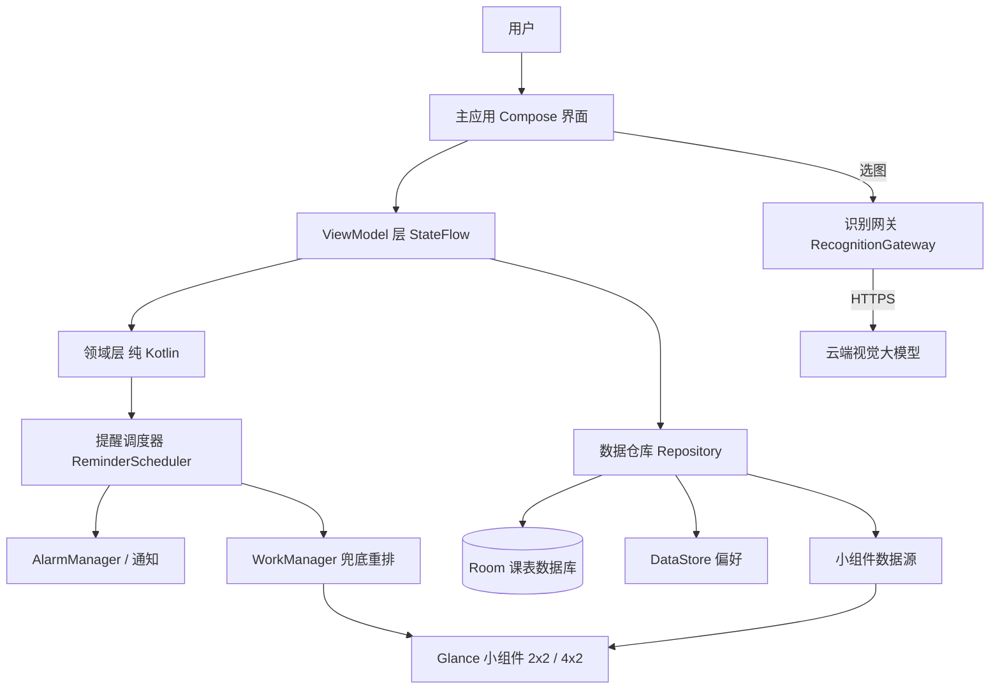

# 智能课表 Android App — 概要设计

**项目：** 智能课表（手机提醒上课小部件） MVP V1.0
**更新日期：** 2026-11-07
**文档版本：** v1.0
**需求基线：** [需求文档.txt](D:/研一/aikaifa/手机提醒上课小部件/需求文档.txt)（PRD V1.0）
**架构基线：** [基础架构落地设计.md](D:/研一/aikaifa/手机提醒上课小部件/docs/基础架构落地设计.md)
**已确认决策：** Android 原生 Kotlin + Glance；小+中尺寸小组件；云端 AI 视觉识别；单双周+指定周次
**阶段边界：** 本文为概要设计，只定义模块边界、职责、接口契约与数据流；不编写应用代码。字段级定义与页面交互细节由详细设计承接。

---

## 1. 先用几句话说明系统怎样工作

用户把教务系统的课表截图丢进应用，云端视觉模型把它读成结构化的课程列表；用户在确认页核对修正后，课程按周次规则存入本地数据库。此后系统完全离线工作：桌面上小尺寸小组件常驻显示「下一节课」，中尺寸显示「今日课程」；到了每节课默认提前 15 分钟，系统闹钟触发上课提醒通知。改课程、调周次、设停课，都只改本地一份权威数据，小组件与提醒随之自动重排。

没有账号、没有服务器、没有云同步。网络只在一个时刻出现：用户主动发起图片识别时。

## 2. 设计目标与关键选择

### 2.1 设计目标

| 目标 | 在设计中的落实方式 |
| --- | --- |
| 识别正确 | 识别结果一律进「导入确认页」，低置信度字段标黄、冲突课程提示，关键字段不猜测；确认前不入库 |
| 展示清晰 | 三种课程状态（未开始/进行中/已结束）贯穿小组件与周课表；下一节课程始终高亮 |
| 提醒可靠 | 提醒由本地 AlarmManager 精确调度 + WorkManager 兜底重排；课程变更后全量重排；非有效周次不提醒 |
| 逻辑可信 | 周次计算、状态判定、提醒计划全部是无 Android 依赖的纯函数，JUnit 单测作为验收依据 |
| 离线可用 | 课表、设置、提醒全本地；无网络时查看与已排提醒均正常 |
| 轻量 | 单模块起步，依赖最少化；小组件不做秒级刷新，按系统允许粒度更新 |

### 2.2 首期采用的设计方向

| 事项 | 选定 | 理由与边界 |
| --- | --- | --- |
| 产品形态 | Android 原生 App（minSdk 26 / targetSdk 35） | 小组件体验与通知调度最可靠 |
| UI | Jetpack Compose + Material 3 | 声明式 UI，浅/深色主题自动跟随系统 |
| 持久存储 | Room（权威数据）+ DataStore（偏好设置） | 本地优先；单数据库，无服务端 |
| 小组件 | Glance（2×2「下一节课」+ 4×2「今日课程」） | Compose 同源 API；大尺寸周课表留后续版本 |
| 识别 | 云端视觉大模型，OpenAI 兼容 chat.completions 协议，base_url/key/model 用户自填 | 复用用户已有 API 资源；识别服务抽象为接口可换实现 |
| 提醒 | AlarmManager（精确）+ WorkManager（兜底与重排） | 本地通知，不依赖推送；国产 ROM 精度限制文档注明并引导电池白名单 |
| 周次 | 学期起始日 + 每门课独立周次规则 | 支持连续区间、单双周、自定义不连续周次（如 1-8、10-16） |
| 时区 | 课程时间存「当日分钟数」（0-1439 int），不存时刻对象 | 规避时区/DST 坑；周几存 1-7 |
| 并发 | 单用户单进程，UI 线程外全部协程 | 不引入并发框架复杂度；数据库写入走单 DAO 串行语义 |

### 2.3 本期不做

账号体系、云同步、备份导出、大尺寸周课表小组件、日历同步、教务系统登录、秒级倒计时刷新、节假日智能调课、iOS 版本。识别结果的「智能纠错」与「多套课表」留后续版本。

---

## 3. 总体架构与可信边界



**可信边界与数据流原则：**

1. **一份权威数据**：Room 数据库是课表唯一权威来源。小组件和提醒都是它的「只读投影」——任何课程变更只改数据库，然后显式触发两个投影的重排，不允许小组件或提醒各自缓存课程数据。
2. **领域层不碰 Android**：`WeekCalculator`、`CourseStatusResolver`、`ReminderPlanner` 是纯函数模块，输入输出均为不可变数据类。UI、Room、AlarmManager 全部隔离在领域层之外，保证单测可信。
3. **网络只在识别网关内**：HTTPS 出网调用只存在于 `RecognitionGateway` 一个模块；其余模块编译期不可见网络 API。
4. **提醒调度是单向管道**：`ReminderPlanner`（纯计算）→ `ReminderScheduler`（Android 执行）。调度器不理解业务规则，只按 Planner 给出的时刻清单设置/取消闹钟。
5. **用户图片出网前必须明示**：识别请求发出前，导入页展示「图片将上传至你配置的识别服务」声明；未配置 API key 时识别入口禁用并提示，不静默上传。

---

## 4. 模块划分与依赖

包根：`com.timetable.widget`（暂定，详细设计定稿包名）

| 模块 | 层 | 职责 | 依赖 |
| --- | --- | --- | --- |
| `domain` | 领域 | WeekCalculator / CourseStatusResolver / ReminderPlanner / 周次规则模型 | 无（纯 Kotlin + kotlinx-datetime 类型映射） |
| `data` | 数据 | Room 实体/DAO/数据库、DataStore 偏好、Repository 门面 | domain |
| `network` | 网络 | RecognitionGateway：图片→结构化课程草稿 JSON | domain |
| `scheduler` | 系统集成 | ReminderScheduler / AlarmReceiver / NotificationHelper / BootReceiver | domain, data |
| `widget` | 系统集成 | Glance 小组件（NextClassWidget / TodayWidget）+ WidgetUpdater | domain, data |
| `ui` | 界面 | 六个页面 + ViewModel + 导航 | domain, data, network, scheduler, widget |
| `app` | 壳 | Application、依赖装配（手工 DI，不引 Hilt）、主题、导航宿主 | 全部 |

依赖方向严格自上而下，`domain` 不被允许 import 任何 `android.*` / `androidx.*`（编译期用独立 Gradle 模块 `:core:domain` 强制）。

### 4.1 领域层公开接口（契约草案）

```kotlin
// 教学周：给定学期第一周周一日期与今天，返回第几周（null = 学期外）
fun currentWeek(semesterStart: LocalDate, today: LocalDate): Int?

// 周次规则：一门课在某教学周是否上课
// WeekPattern = All | Odd | Even | Custom(Set<Int>)
fun courseActiveInWeek(course: Course, week: Int): Boolean

// 课程状态（当日分钟比较）
fun statusOf(course: Course, nowMinuteOfDay: Int): CourseStatus  // NotStarted | Ongoing | Ended

// 提醒计划：给定全部有效课程 + 学期设置 + 当前时刻，
// 输出未来 7 天内的提醒触发时刻清单（已过滤无效周次/停课日/过期课）
fun planReminders(courses: List<Course>, settings: SemesterSetting, now: LocalDateTime): List<PlannedReminder>

// 节次映射：识别出的"第 X-Y 节" → 开始/结束分钟数（依据 PeriodTime 作息表）
fun periodsToMinutes(periods: IntRange, timetable: List<PeriodTime>): Pair<Int, Int>?
```

这些签名是实现必须遵守的契约；详细设计阶段只允许扩展（默认参数、重载），不允许改语义。

## 5. 用户旅程与页面组织

### 5.1 首次使用旅程

安装 → 欢迎页 → 设置学期（起始日/总周数/节次作息，可跳过默认 20 周）→ 导入课表（选图上传识别）→ 导入确认页核对修正 → 授权通知权限 → 引导添加小组件 → 首页。

每一步都可以跳过或后补：没有任何课程时，首页与小组件显示「暂无课程，点击导入课表」空态，不阻塞。

### 5.2 页面清单

| 页面 | 路由 | 主要内容 | 来源模块 |
| --- | --- | --- | --- |
| 首页 | `home` | 今日日期、下一节课程卡、今日课程时间线、周课表入口 | ui |
| 周课表 | `week?weekNo=` | 周一至周日课程网格、周次切换、当日列高亮 | ui |
| 图片导入 | `import` | PhotoPicker 选图、上传声明、识别进度、失败重试 | ui+network |
| 导入确认 | `confirm/{draftId}` | 可编辑课程列表（名称/星期/节次/教室/教师/周次）、低置信度标黄、冲突提示、入库 | ui+data |
| 课程详情/编辑 | `course/{id}` 或 `course/new` | 全字段编辑、周次选择器、单课提醒开关、停课/删除 | ui+data |
| 设置 | `settings` | 学期设置、作息时间表（节次模式）、默认提醒提前量、识别服务配置、主题 | ui+data |

导航：单 Activity + Navigation Compose，两级深度，无 Tab。

### 5.3 日常使用旅程

解锁手机 → 桌面小组件（免打开 App）→ 提前收到通知 → 点小组件进首页看详情 → 周末改下周课表。

## 6. 核心流程设计

### 6.1 图片导入流程（唯一有网络的流程）

```
选图(PhotoPicker) → 压缩至 ≤2048px JPEG → 上传声明确认
→ RecognitionGateway 请求视觉模型（结构化 JSON 输出 prompt）
→ 解析/校验响应（字段缺失标低置信度，不猜）→ 存 RecognitionDraft
→ 导入确认页（可编辑、冲突检测、节次→时间映射预览）
→ 用户确认 → 批量写 Course → 触发提醒重排 + 小组件刷新 → 跳周课表
```

失败路径：网络失败/超时 → 提示重试，草稿不丢；模型返回无法解析 → 明确提示「识别失败，可重试或手动添加」，不写入半成品数据；图片模糊/无表格结构 → 由模型返回的置信度信号触发「建议重新拍摄清晰截图」提示。

**识别输出协议**（网关与模型约定的 JSON Schema，详细设计定稿字段校验规则）：

```json
{ "courses": [ { "name": "", "dayOfWeek": 1-7, "periodStart": null, "periodEnd": null,
    "startTime": "HH:mm 或 null", "endTime": "同上", "weeks": "原文如 1-8,10-16 或 单周",
    "weeksParsed": [1,2,3], "location": "", "teacher": "", "confidence": 0.0-1.0 } ] }
```

`weeks` 保留模型原文供用户对照，`weeksParsed` 为解析结果；两者不一致时确认页整行标黄。

### 6.2 提醒调度流程

```
任何课程/学期/作息变更
→ ReminderPlanner.planReminders() 重新计算未来 7 天清单
→ ReminderScheduler 全量替换：取消旧闹钟 → setExactAndAllowWhileIdle 逐条设置
→ 同时注册 WorkManager 兜底任务（每日 + 课程变更时）重建计划
→ AlarmReceiver 触发 → NotificationHelper 发通知（标题"15 分钟后上课"，正文=课程名|时间|教室）
```

规则落点：非有效周次/停课日不出现在计划里；已过期时刻不补发；通知权限未授予时设置页与首次导入完成后均有引导；设备重启后 BootReceiver 重建全部闹钟。

### 6.3 小组件刷新流程

```
触发源（任一）：WorkManager 每 15 分钟 | 午夜日切 Alarm | 课程/学期变更回调 | 系统时区/时间变化广播
→ WidgetUpdater 从 Repository 读取当天课程 + 下一节课 → 纯函数计算状态与"距上课 X 分钟"文案
→ Glance 更新 2×2 与 4×2 → 点击 2×2 跳课程详情，点击 4×2 跳首页
```

刷新粒度刻意保守（15 分钟），保证「下一节」「进行中」状态在可接受误差内正确且不耗电；不做每秒倒计时（PRD 已豁免）。

### 6.4 课程修改流程

编辑保存 → Room 写入（事务）→ 同一事务后触发三件事：提醒全量重排、小组件立即刷新、首页 StateFlow 自动更新（Room Flow 观察）。停课（暂停日期）与删除同样走此管道，保证「改一处、处处生效」。

## 7. 逻辑数据设计

### 7.1 实体

```
SemesterSetting（单行表）
  id=1, firstWeekStartDate: LocalDate, totalWeeks: Int,
  defaultReminderLeadMinutes: Int = 15, timetableMode: PERIOD | EXACT_TIME

PeriodTime（作息表，节次模式用）
  id, periodIndex: Int, startTime: String(HH:mm), endTime: String(HH:mm)

Course
  id: Long, name: String,
  dayOfWeek: Int (1=周一…7=周日),
  startMinuteOfDay: Int, endMinuteOfDay: Int,
  location: String?, teacher: String?, colorArgb: Long?, note: String?,
  weekPattern: ALL | ODD | EVEN | CUSTOM, customWeeks: String("1,2,5-8,10-16"),
  reminderEnabled: Boolean, reminderLeadMinutes: Int?,   -- null=用全局默认
  pausedDates: String("2026-11-20,2026-11-27")           -- 停课日期列表

RecognitionDraft（导入暂存，确认后可删）
  id, createdAt, rawImageUri, coursesJson（模型原始返回+置信度）
```

### 7.2 关键派生规则（存计算不存状态）

- 「今天的课」「下一节课」「本周是第几周」一律实时由领域层计算，不落库为冗余状态——避免改了课程忘记刷派生表的一致性问题。
- 课程冲突（同时段重叠）不入库拦截，保存时允许，但查询页与确认页高亮提示（PRD 4.2）。

### 7.3 迁移与版本

Room schema version 1 起步，导出 schema JSON 进 git；后续字段变更走 Migration，不破坏用户已存课表。

## 8. 状态设计

应用内没有复杂的长时任务，状态分三类：

| 状态 | 位置 | 说明 |
| --- | --- | --- |
| 权威数据 | Room | 课程、学期、作息 |
| 界面状态 | ViewModel StateFlow | 页面加载/空态/错误，Room Flow 派生 |
| 识别任务状态 | 导入 ViewModel 内存态 | 识别中/成功/失败，App 被杀则任务作废（可重试，不恢复进度） |
| 提醒计划 | 系统 AlarmManager + WorkManager | 系统持有的调度，可由 BootReceiver 完全重建 |

小组件自身无状态：每次刷新从 Repository 全量重读，数据量小（一天最多十余节课）无性能问题。

## 9. 非功能设计

| 维度 | 设计 |
| --- | --- |
| 性能 | 冷启动 <1s 量级（单模块小 App）；小组件刷新在 WorkManager 后台线程完成 |
| 电量 | 唯一定时器是 15 分钟 WorkManager + 每日午夜 Alarm；无轮询网络 |
| 稳定性 | 重启后 BootReceiver 重建闹钟；数据库 Room 自带容错；App 任意时刻被杀不影响已排提醒与小组件（系统级持有） |
| 隐私 | 无账号、无遥测；唯一出网是用户主动识别且先明示；API key 存 DataStore（设备本地） |
| 兼容 | minSdk 26（Android 8.0，通知渠道必需），targetSdk 35；精确闹钟权限在设置页引导授权并检测 |
| 可用性 | 所有识别/权限/空数据状态均有明确文案；浅深色跟随系统 |

## 10. 模块交互与输出契约

| 交互 | 触发 | 契约 |
| --- | --- | --- |
| 确认页 → Repository | 用户点「确认导入」 | 批量插入 Course，返回成功条数；失败整批回滚 |
| Repository 变更 → Scheduler | 任何课程/学期写操作后 | Scheduler 无条件全量重排（幂等，先取消后设置） |
| Repository 变更 → WidgetUpdater | 同上 | WidgetUpdater 幂等刷新两枚小组件 |
| AlarmReceiver → NotificationHelper | 闹钟到点 | 按 PlannedReminder 载荷发通知，渠道 `class_reminder`，不做事后补发 |
| 识别网关 → 确认页 | 识别完成 | RecognitionDraft id；页面从草稿渲染，模型原文保留可对照 |

## 11. 分期设计与交付里程碑

与[基础架构落地设计.md](D:/研一/aikaifa/手机提醒上课小部件/docs/基础架构落地设计.md)批次对应，概要设计层面各批次交付的可验证边界：

| 批次 | 交付边界 | 验收方式 |
| --- | --- | --- |
| 0 环境准备 | JDK17 + Android SDK 可构建 | `java -version` / `sdkmanager --list_installed` 真实输出 |
| 1 骨架+领域层 | 空壳 APK + 三个纯函数模块 + 全量单测 | `gradlew testDebugUnitTest` 全绿 + `assembleDebug` 出包 |
| 2 数据+管理 UI | Room + 周课表/课程编辑/设置可用 | DAO 单测 + 手动走查截图 |
| 3 识别导入 | 选图→识别→确认→入库全链路 | 真实课表截图端到端跑通 |
| 4 小组件+提醒 | 2×2/4×2 + 提醒全链路 | 模拟器/真机：加小组件、改课、收通知 |
| 5 集成验收 | release APK + PRD 八条验收逐条核对 | reviewer 走查 + 安装包交付 |

## 12. 需求到设计追踪

| PRD 条款 | 概要设计落点 |
| --- | --- |
| 2.1 图片导入 | §6.1 导入流程、§7.1 RecognitionDraft、§10 识别协议 |
| 2.2 课程表管理 | §5.2 周课表/详情页、§6.4 修改流程、§7 数据模型 |
| 2.3 桌面小组件 | §6.3 刷新流程、§4 widget 模块；大尺寸留后续（§2.3） |
| 2.4 上课提醒 | §6.2 调度流程、§4 scheduler 模块 |
| 2.5 课程时间设置 | §7.1 SemesterSetting.timetableMode + PeriodTime、§4.1 periodsToMinutes |
| 4.1 周次计算 | §4.1 WeekCalculator 契约、§7.1 weekPattern/customWeeks |
| 4.2 课程状态 | §4.1 statusOf、§7.2 冲突不拦截 |
| 4.3 数据保存 | §3 可信边界、§9 隐私/离线 |
| 八 MVP 验收标准 | §11 批次 5 逐条核对 |
| 九 待定决策 | 已确认四项见文首；其余按推荐项落入 §2.2 |

## 13. 主要风险与后续设计交付

| 风险 | 概要设计对策 | 遗留到详细设计 |
| --- | --- | --- |
| 云端识别结构化输出不稳定 | 识别协议约定 JSON Schema + 置信度字段；解析失败不写库 | prompt 定稿、字段校验规则、重试策略 |
| 国产 ROM 精确闹钟受限 | WorkManager 兜底重建 + 白名单引导文案 | 各厂商检测与引导细节 |
| 节次课表与非节次课表混排 |timetableMode 全局模式 + 单课可直接存时间覆盖 | 混排场景的确认页交互 |
| 模拟器验证小组件局限 | 批次 5 支持真机侧载 | 无 |

**下一层设计交付物：** 详细设计（页面字段级交互、Room schema DDL、识别 prompt 与校验规则、通知文案矩阵、边界用例表）。本文与架构文档作为其输入基线。
